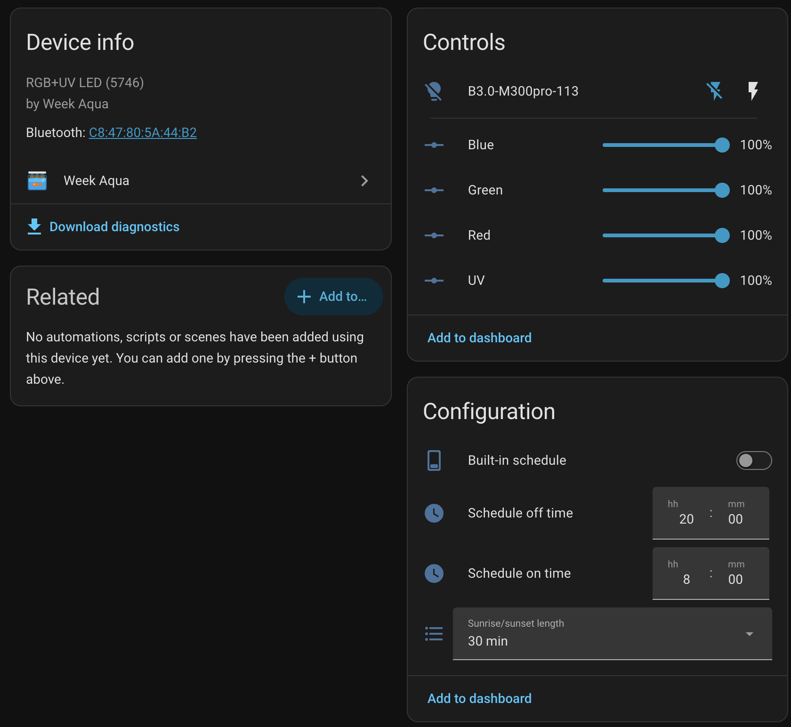
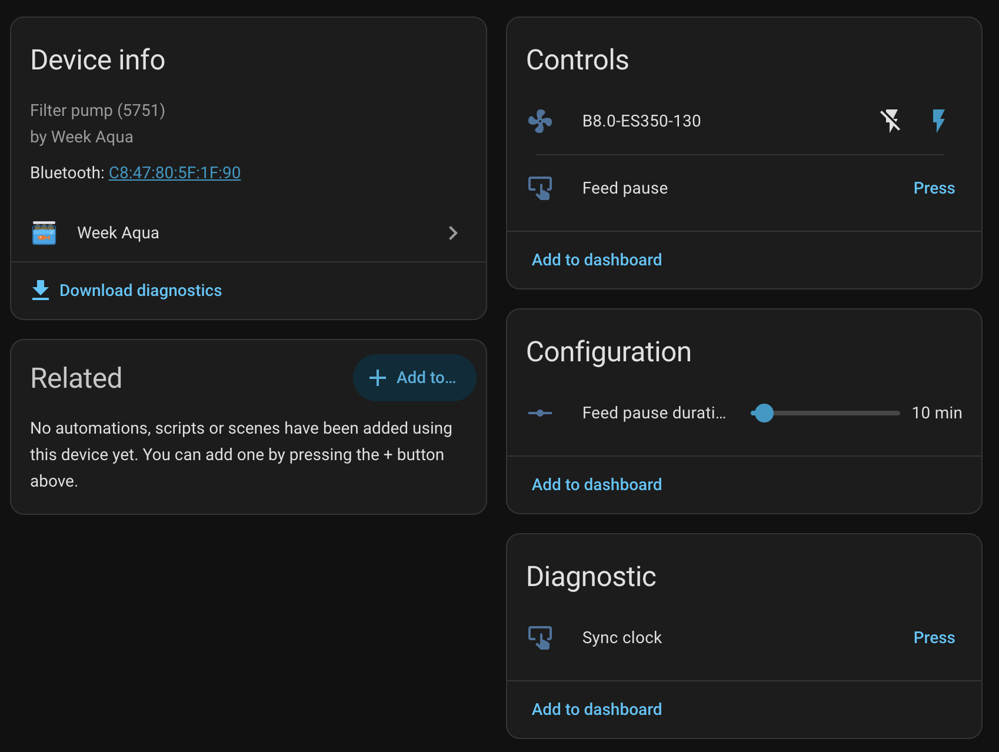
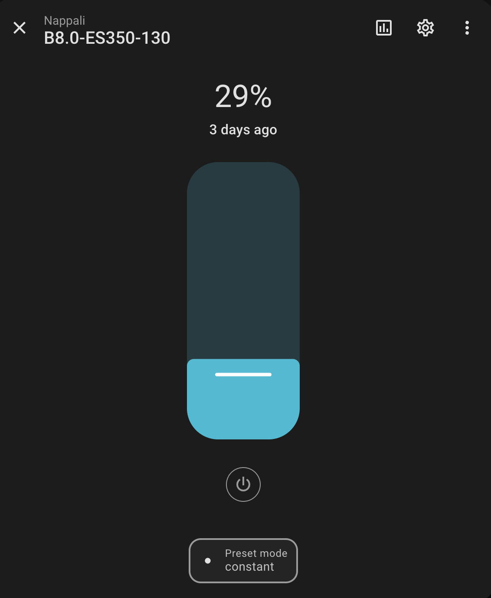
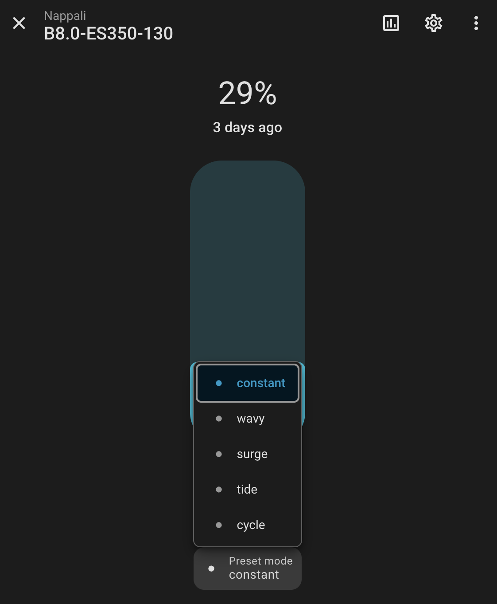

<p align="center">
  
</p>

<h1 align="center">Week Aqua Home Assistanthez</h1>

<p align="center">
  Week Aqua akváriumlámpák és szűrőpumpák helyi vezérlése Bluetooth-on.<br>
  Felhő és telefonos alkalmazás nélkül, ESPHome Bluetooth proxykon keresztül is.
</p>

<p align="center">
  <a href="https://github.com/novamill/ha-week-aqua/releases"></a>
  <a href="https://hacs.xyz"></a>
  <a href="https://github.com/novamill/ha-week-aqua/actions/workflows/validate.yml"></a>
  <a href="https://github.com/novamill/ha-week-aqua/actions/workflows/tests.yml"></a>
  <a href="LICENSE"></a>
</p>

<p align="center">
  <a href="README.md">English</a> · <b>Magyar</b>
</p>

---

> [!WARNING]
> **Nem hivatalos integráció: mindenki a saját felelősségére használja.** A
> projekt nem áll kapcsolatban a Week Aqua termékek gyártójával, és a gyártó
> nem támogatja. Visszafejtett protokollt használ, és semmilyen garanciát nem
> vállal. Az első eszköz hozzáadásakor el kell fogadnod ezt a
> [jogi nyilatkozatot](#jogi-nyilatkozat).

## Funkciók

- **Automatikus felismerés.** Az eszközök megjelennek a Home Assistantben,
  amint Bluetooth-hatótávon belül vannak. Nem kell címeket begépelni.
- **Mindent tud, amit az alkalmazás ezeknél a modelleknél:**
  - színcsatornák
  - a lámpa beépített napi időzítése napfelkelte/naplemente áttűnéssel
  - a pumpa áramlása és hullámmintái
  - etetési szünet
  - az eszközök átnevezése
- **Teljesen helyi.** A Home Assistant saját Bluetooth-kezelését használja,
  így helyi adapterrel és tetszőleges számú
  [ESPHome Bluetooth proxyval](https://esphome.io/components/bluetooth_proxy.html)
  is működik.
- **Kíméli a rádiót.** Csak parancsküldéskor kapcsolódik, és 15 másodperc
  tétlenség után bontja a kapcsolatot, így egy proxy sok eszközt kiszolgálhat.
- **Pontos óra.** Az eszközök óráját minden kapcsolódáskor és naponta is
  beállítja, így a beépített időzítés nem csúszik el, és a nyári/téli
  időszámítás váltását is követi.
- **Biztonságos színek.** Ugyanazt a LED-teljesítménykorlátot alkalmazza, mint
  a hivatalos alkalmazás.

## Képernyőképek

<table>
  <tr>
    <td width="50%"></td>
    <td width="50%"></td>
  </tr>
  <tr>
    <td align="center"><b>Lámpa:</b> színcsatornák és a beépített napi időzítés</td>
    <td align="center"><b>Pumpa:</b> áramlás, etetési szünet és annak hossza</td>
  </tr>
</table>

<table>
  <tr>
    <td width="50%" align="center"></td>
    <td width="50%" align="center"></td>
  </tr>
  <tr>
    <td align="center">Áramlás</td>
    <td align="center">Hullámminták</td>
  </tr>
</table>

## Támogatott eszközök

| Eszköz | Példák | Állapot |
|---|---|---|
| R/G/B/UV LED-lámpák (`5746` típus) | B3.0 Mini9 Pro, M300 Pro | ✅ Támogatott, tesztelt |
| Szűrő- és hullámpumpák (`5751` típus) | B8.0 ES350 | ✅ Támogatott. Az áramlás, a surge minta és az etetési szünet tesztelt; a tide, cycle és wavy minta elkészült, de nincs tesztelve. |
| Egyéb Week Aqua lámpák és az elosztó (`5745`, `5747`–`5750`, `5752` típus) | | ❌ Még nem. A támogatásukhoz segíthetsz, lásd a [közreműködési útmutatót](CONTRIBUTING.md) (angol). |

Nem tudod, milyen típusú az eszközöd? Futtasd a `python tools/weekaqua.py scan`
parancsot (lásd [Parancssori eszköz](#parancssori-eszköz)). Ez kilistázza a
hatótávon belüli összes Week Aqua eszközt a típusával együtt, a nem
támogatottakat is.

## Telepítés

### HACS (ajánlott)

[](https://my.home-assistant.io/redirect/hacs_repository/?owner=novamill&repository=ha-week-aqua&category=integration)

1. Kattints a fenti gombra, vagy a HACS-ban nyisd meg a **⋮ → Egyéni tárolók**
   (Custom repositories) menüt, és add hozzá a
   `https://github.com/novamill/ha-week-aqua` címet **Integráció** típussal.
2. Töltsd le a **Week Aqua** integrációt, és indítsd újra a Home Assistantet.

### Kézi telepítés

Másold a `custom_components/week_aqua` mappát a
[legújabb kiadásból](https://github.com/novamill/ha-week-aqua/releases/latest)
a `<config>/custom_components/` mappába, és indítsd újra a Home Assistantet.

### Eszközök hozzáadása

1. **Zárd be a Week Aqua alkalmazást a telefonodon.** Az eszközök egyszerre
   csak egy kapcsolatot fogadnak.
2. Nyisd meg a **Beállítások → Eszközök és szolgáltatások** oldalt. A
   felismert eszközök itt jelennek meg; kattints a **Hozzáadás** gombra. Vagy
   válaszd az **Integráció hozzáadása → Week Aqua** lehetőséget, és válassz a
   hatótávon belüli eszközök közül.
3. Az első eszköz hozzáadásakor olvasd el a
   [jogi nyilatkozatot](#jogi-nyilatkozat), és jelöld be a
   **Megértettem, és az integrációt a saját felelősségemre használom**
   négyzetet. Enélkül
   a beállítás nem folytatódik. Csak egyszer kérdezi meg.

**Követelmények:** Home Assistant 2025.2 vagy újabb, és egy Bluetooth-adapter
vagy ESPHome Bluetooth proxy az akvárium hatótávolságán belül.

## Mit kapsz

Ha a Home Assistant nyelve magyar, az entitások, a beállítási lépések és a
nyilatkozat is magyarul jelennek meg. Zárójelben az angol nevük.

### Lámpák

| Entitás | Mire való |
|---|---|
| **Lámpa** (a lámpa saját neve) | Be/ki, fényerő és szín. A szín RGBW, és **a W az UV LED-eket vezérli**. A fényerő a legerősebb csatorna értéke. |
| **Piros / Zöld / Kék / UV** (Red / Green / Blue / UV) | Csatornánként egy 0–100%-os csúszka, mint az alkalmazásban. A csúszka mozgatása az új keverékkel bekapcsolja a lámpát. |
| **Beépített időzítés** (Built-in schedule) | Bekapcsolva a lámpa minden nap magától be- és kikapcsol, akkor is, ha a Home Assistant nem fut. |
| **Időzítés bekapcsolási / kikapcsolási ideje** (Schedule on time / off time) | A napi időablak. A 00:00-s kikapcsolási idő éjfelet jelent. |
| **Napfelkelte/naplemente hossza** (Sunrise/sunset length) | Az áttűnés hossza: nincs, 30, 60, 90, 120 vagy 150 perc. Egy érték vonatkozik a napfelkeltére és a naplementére is. |
| **Bluetooth-név** (Bluetooth name) | A név, amelyet a lámpa hirdet, és amelyet az alkalmazás mutat. Szerkesztésével átnevezheted a lámpát. |
| **Óra szinkronizálása** (Sync clock) | Most beállítja a lámpa óráját. Ez automatikusan is megtörténik, így ritkán van rá szükség. |

A lámpa `red`, `green`, `blue` és `uv` attribútumai a teljesítménykorlát
alkalmazása után ténylegesen elküldött értékeket mutatják. A lámpa meghajtói
ennyit engednek: `0.39·R + 0.41·G + 0.53·B + 0.11·UV ≤ 100`. Ha egy keverék
többet kér, az összes csatornát azonos arányban csökkenti, így a szín nem
változik.

### Pumpák

| Entitás | Mire való |
|---|---|
| **Pumpa** (ventilátor entitás, a pumpa saját neve) | Áramlás 1–100% és hullámminta: Állandó, Hullámzó, Lökésszerű, Árapály, Ciklikus (automatizálásokban: `constant`, `wavy`, `surge`, `tide`, `cycle`). Kikapcsolva a pumpa leáll. Bekapcsolva visszaállítja az utolsó áramlást és mintát. |
| **Etetési szünet** (Feed pause) | Az etetési szünet idejére leállítja a pumpát. A pumpa magától újraindul. |
| **Etetési szünet hossza** (Feed pause duration) | 5–60 perc. |
| **Bluetooth-név**, **Óra szinkronizálása** | Mint a lámpáknál. |

### Műveletek

| Művelet | Használat |
|---|---|
| `week_aqua.set_schedule` | Egy hívással beállítja a be- és kikapcsolási időt, az áttűnés hosszát, és bekapcsolja a beépített időzítést. |
| `week_aqua.clear_schedule` | Kikapcsolja a beépített időzítést, így a lámpát csak a Home Assistant kapcsolja. |

## Hogyan időzítsd a lámpákat

Ezek az eszközök **nem jelentik az állapotukat**. A Home Assistant azt mutatja,
amit utoljára elküldött, és ezt újraindítás után is megőrzi. Kivétel a
Bluetooth-név: azt az eszközről olvassa be. Két megközelítés közül választhatsz:

**A lámpa időzítse magát (mint az alkalmazásban).** Állítsd be a be- és
kikapcsolási időt és a napfelkelte/naplemente hosszát, majd kapcsold be a
**Beépített időzítés** kapcsolót. A lámpa akkor is követi az időzítést, ha a
Home Assistant nem fut. A Home Assistant viszont nem látja, amikor a lámpa
magától be- vagy kikapcsol.

**A Home Assistant időzítse.** Hagyd kikapcsolva a **Beépített időzítés**
kapcsolót, és használj automatizálásokat. Így bármit megvalósíthatsz: több
színfázist naponta, UV holdfényt, a nap járását követő világítást, vagy a
pumpa szüneteltetését etetéskor.

<details>
<summary>Példa: három színfázis és holdfény</summary>

```yaml
automation:
  - alias: Akvárium reggel
    triggers:
      - trigger: time
        at: "08:00:00"
    actions:
      - action: light.turn_on
        target:
          entity_id: light.mini9pro_30
        data:
          rgbw_color: [255, 180, 120, 40]
          brightness: 120

  - alias: Akvárium délben
    triggers:
      - trigger: time
        at: "11:00:00"
    actions:
      - action: light.turn_on
        target:
          entity_id: light.mini9pro_30
        data:
          rgbw_color: [255, 255, 255, 200]
          brightness: 255

  - alias: Akvárium holdfény
    triggers:
      - trigger: time
        at: "21:00:00"
    actions:
      - action: light.turn_on
        target:
          entity_id: light.mini9pro_30
        data:
          rgbw_color: [0, 0, 40, 255]
          brightness: 25

  - alias: Akvárium ki
    triggers:
      - trigger: time
        at: "23:00:00"
    actions:
      - action: light.turn_off
        target:
          entity_id: light.mini9pro_30
```

</details>

<details>
<summary>Példa: a pumpa szüneteltetése etetéskor</summary>

```yaml
script:
  feed_fish:
    sequence:
      - action: number.set_value
        target:
          entity_id: number.es350_feed_pause_duration
        data:
          value: 15
      - action: button.press
        target:
          entity_id: button.es350_feed_pause
```

</details>

## Hibaelhárítás

| Probléma | Teendő |
|---|---|
| Az eszközt nem ismeri fel | Zárd be a Week Aqua alkalmazást, mert az foglalja a kapcsolatot. Ellenőrizd, hogy van-e Bluetooth-adapter vagy proxy az akvárium közelében. Egyes pumpák csak néhány másodpercenként hirdetik magukat, ezért várj egy percet. |
| Az eszköz elérhetetlenné válik, vagy a parancsok nem mennek át | Általában a hatótávolság a gond: a víz, az üveg és a szekrény elnyeli a Bluetooth-jelet. Tegyél egy `active: true` beállítású [ESPHome Bluetooth proxyt](https://esphome.io/components/bluetooth_proxy.html) az akvárium közelébe. |
| A lámpa rossz időben kapcsol | Nyomd meg az **Óra szinkronizálása** gombot, és ellenőrizd a Home Assistant időzónáját. Az órák egyébként naponta 03:07-kor szinkronizálódnak. |
| A Home Assistant állapota nem egyezik a lámpáéval | A lámpát a telefonos alkalmazásból vagy a beépített időzítése változtatta meg. Állítsd be egyszer a Home Assistantből, és újra egyezni fognak. |

Hiba bejelentésekor csatold a diagnosztikát (**eszközoldal → ⋮ → Diagnosztika
letöltése**) és egy hibakeresési naplót:

```yaml
logger:
  logs:
    custom_components.week_aqua: debug
```

## Parancssori eszköz

A [`tools/weekaqua.py`](tools/weekaqua.py) ugyanazzal a protokollkóddal,
közvetlenül számítógépről vezérli az eszközöket. Home Assistant nélküli
teszteléshez hasznos (Python ≥ 3.11, `pip install bleak`):

```sh
python tools/weekaqua.py scan
python tools/weekaqua.py light Mini9Pro-30 80 60 70 40      # R G B UV %
python tools/weekaqua.py schedule Mini9Pro-30 08:00 20:00 --ramp 60
python tools/weekaqua.py pump ES350 constant 70
python tools/weekaqua.py feed ES350 10
python tools/weekaqua.py rename Mini9Pro-30 "B3.0-Bal"
```

## Hogyan működik

A hivatalos alkalmazásból és Bluetooth-felvételekből kikövetkeztetett
protokoll leírása a [docs/PROTOCOL.md](docs/PROTOCOL.md) fájlban található
(angol nyelvű).

## Közreműködés

Szívesen fogadunk hibajelentéseket, más modellekről készült felvételeket és
pull requesteket. Lásd a [CONTRIBUTING.md](CONTRIBUTING.md) fájlt (angol
nyelvű).

## Jogi nyilatkozat

**Az integráció telepítésével vagy használatával elfogadod, hogy azt a saját
felelősségedre használod.** A Home Assistant az első eszköz hozzáadásakor kéri
ennek megerősítését.

- Ez egy független közösségi projekt. Nem áll kapcsolatban a Week Aqua
  termékek gyártójával, és a gyártó nem hagyta jóvá és nem támogatja. A „Week
  Aqua” név csak a kompatibilis eszközök azonosítására szolgál.
- Az eszközöket a hivatalos alkalmazásból visszafejtett protokollal vezérli.
  Hibákat tartalmazhat, és a gyártó firmware-frissítései működésképtelenné
  tehetik.
- A szoftvert **„ahogy van”, mindennemű garancia nélkül** biztosítjuk, ahogy
  azt az [MIT licenc](LICENSE) kimondja. A szerzők nem felelnek az
  eszközeidben, az akváriumodban, az élőlényekben vagy más vagyontárgyakban
  keletkezett károkért. Ide tartozik az is, ha a lámpák, pumpák vagy
  időzítések nem a várt módon működnek, ha az eszközök elérhetetlenné válnak,
  vagy ha a parancsok nem érkeznek meg.
- Ne bízd az élőlények életben tartását kizárólag erre az integrációra.
  Figyeld az akváriumodat, és gondoskodj róla, hogy a pumpák és lámpák hiba
  esetén is biztonságos állapotban maradjanak.

## Licenc

[MIT](LICENSE). A licenc szövege angol nyelven érvényes.
