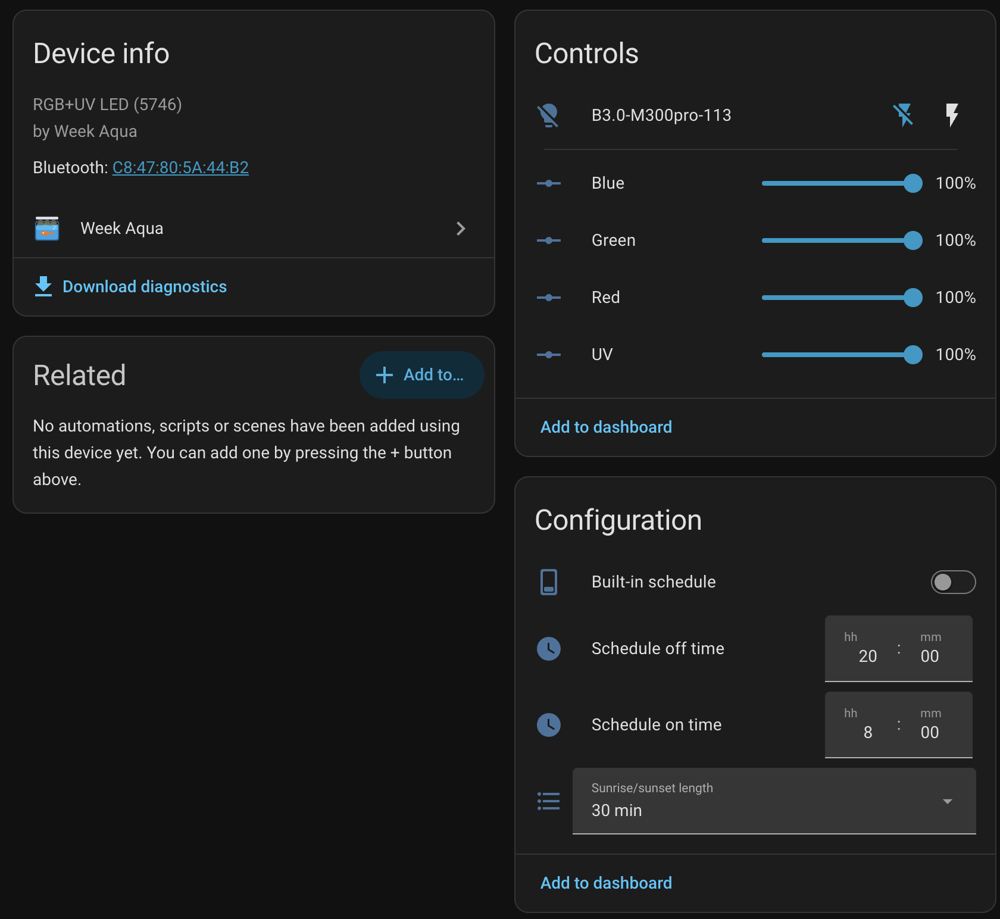
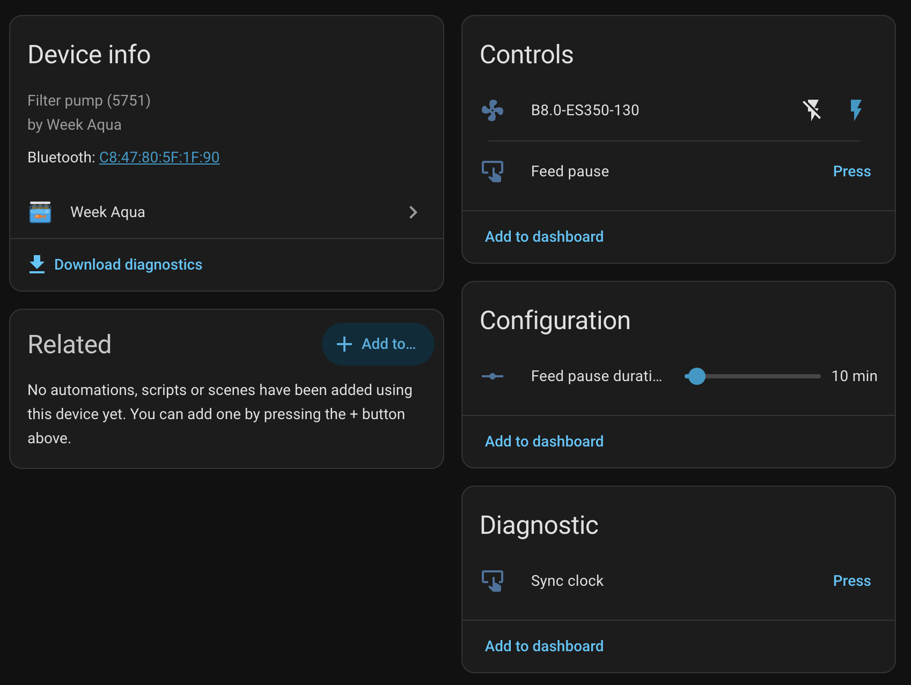
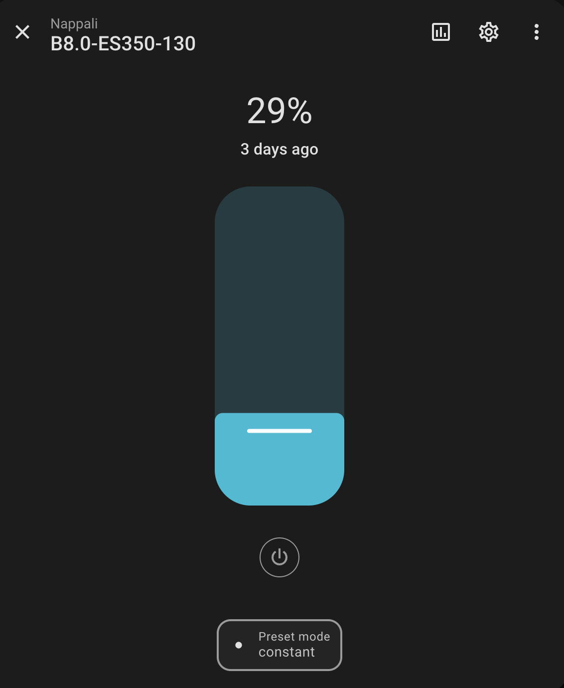
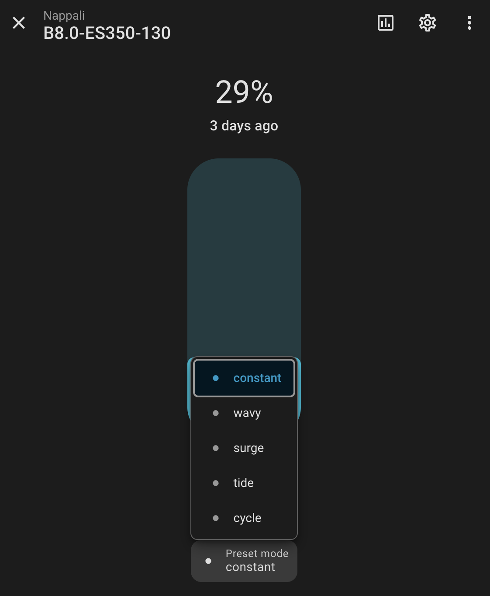

<p align="center">
  
</p>

<h1 align="center">Week Aqua for Home Assistant</h1>

<p align="center">
  Local Bluetooth control of Week Aqua aquarium lights and filter pumps.<br>
  No cloud, no phone app, works through ESPHome Bluetooth proxies.
</p>

<p align="center">
  <a href="https://github.com/novamill/ha-week-aqua/releases"></a>
  <a href="https://hacs.xyz"></a>
  <a href="https://github.com/novamill/ha-week-aqua/actions/workflows/validate.yml"></a>
  <a href="https://github.com/novamill/ha-week-aqua/actions/workflows/tests.yml"></a>
  <a href="LICENSE"></a>
</p>

---

> [!WARNING]
> **Unofficial integration: use at your own risk.** This project is not
> affiliated with or supported by the manufacturer of Week Aqua products. It
> uses a reverse-engineered protocol and comes with no warranty. You must
> accept this [disclaimer](#disclaimer) when adding your first device.

## Features

- **Automatic discovery.** Devices appear in Home Assistant as soon as they
  are in Bluetooth range. No addresses to type.
- **Everything the app can do for these models:**
  - colour channels
  - the lamp's built-in daily schedule with sunrise/sunset fade
  - pump flow and wave patterns
  - feed pause
  - device renaming
- **Fully local.** Uses Home Assistant's own Bluetooth stack, so it works with
  a local adapter or any number of
  [ESPHome Bluetooth proxies](https://esphome.io/components/bluetooth_proxy.html).
- **Kind to the radio.** Connects only to send a command and disconnects
  after 15 s idle, so one proxy can serve many devices.
- **Correct clock.** Each device's clock is synced on every connection and
  daily, so built-in schedules survive drift and DST changes.
- **Safe colours.** Applies the same LED power budget as the official app.

## Screenshots

<table>
  <tr>
    <td width="50%"></td>
    <td width="50%"></td>
  </tr>
  <tr>
    <td align="center"><b>Light:</b> colour channels and the built-in daily schedule</td>
    <td align="center"><b>Pump:</b> flow, feed pause and its duration</td>
  </tr>
</table>

<table>
  <tr>
    <td width="50%" align="center"></td>
    <td width="50%" align="center"></td>
  </tr>
  <tr>
    <td align="center">Flow control</td>
    <td align="center">Wave patterns</td>
  </tr>
</table>

## Supported devices

| Device | Examples | Status |
|---|---|---|
| R/G/B/UV LED lights (type `5746`) | B3.0 Mini9 Pro, M300 Pro | ✅ Supported, tested |
| Filter and wave pumps (type `5751`) | B8.0 ES350 | ✅ Supported. Flow, surge and feed pause tested; tide, cycle and wavy implemented but untested. |
| Other Week Aqua lights and the power strip (types `5745`, `5747`–`5750`, `5752`) | | ❌ Not yet. See [Contributing](CONTRIBUTING.md) to help add them. |

Not sure which type you have? Run `python tools/weekaqua.py scan` (see
[Command-line tool](#command-line-tool)). It lists every Week Aqua device in
range with its type, including unsupported ones.

## Installation

### HACS (recommended)

[](https://my.home-assistant.io/redirect/hacs_repository/?owner=novamill&repository=ha-week-aqua&category=integration)

1. Click the button above, or in HACS open **⋮ → Custom repositories**, add
   `https://github.com/novamill/ha-week-aqua` with type **Integration**.
2. Download **Week Aqua** and restart Home Assistant.

### Manual

Copy `custom_components/week_aqua` from the
[latest release](https://github.com/novamill/ha-week-aqua/releases/latest)
into `<config>/custom_components/` and restart Home Assistant.

### Adding devices

1. **Close the Week Aqua app on your phone.** Each device accepts only one
   connection at a time.
2. Go to **Settings → Devices & services**. Discovered devices are listed
   there; click **Add**. Or use **Add integration → Week Aqua** to choose from
   the devices in range.
3. When adding your first device, read the [disclaimer](#disclaimer) and tick
   **I understand and use this integration at my own risk**. Setup doesn't
   continue without it, and it is asked only once.

**Requirements:** Home Assistant 2025.2 or newer, and a Bluetooth adapter or
ESPHome Bluetooth proxy within range of the tank.

## What you get

### Lights

| Entity | What it does |
|---|---|
| **Light** | On/off, brightness and colour. The colour is RGBW, and **W drives the UV LEDs**. Brightness is the strongest channel. |
| **Red / Green / Blue / UV** | One 0–100 % slider per channel, like in the app. Moving a slider lights the lamp with the new mix. |
| **Built-in schedule** | When on, the lamp switches itself on and off every day, even when Home Assistant is offline. |
| **Schedule on time / off time** | The daily window. An off time of 00:00 means midnight. |
| **Sunrise/sunset length** | Fade length: off, 30, 60, 90, 120 or 150 minutes. One length applies to both sunrise and sunset. |
| **Bluetooth name** | The name the lamp advertises and the app shows. Edit it to rename the lamp. |
| **Sync clock** | Sets the lamp's clock now. This happens automatically, so you rarely need it. |

The light's `red`, `green`, `blue` and `uv` attributes show the output actually
sent after the power budget. The lamp's drivers allow
`0.39·R + 0.41·G + 0.53·B + 0.11·UV ≤ 100`. If a mix asks for more, all
channels are scaled down together, so the colour stays the same.

### Pumps

| Entity | What it does |
|---|---|
| **Fan** | Flow 1–100 % and the wave pattern (`constant`, `wavy`, `surge`, `tide`, `cycle`). Turning it off stops the pump. Turning it on restores the last flow and pattern. |
| **Feed pause** | Stops the pump for the feed pause duration. The pump restarts by itself. |
| **Feed pause duration** | 5–60 minutes. |
| **Bluetooth name**, **Sync clock** | As for lights. |

### Actions

| Action | Use |
|---|---|
| `week_aqua.set_schedule` | Set on time, off time and fade length, and turn the built-in schedule on, in one call. |
| `week_aqua.clear_schedule` | Turn the built-in schedule off, so only Home Assistant switches the lamp. |

## Choosing how to schedule your lights

These devices **don't report their state**. Home Assistant shows what it last
sent, and keeps that across restarts. The Bluetooth name is the exception: it
is read from the device. Pick one of two approaches:

**Let the lamp schedule itself (like the app).** Set the on and off times and
the sunrise/sunset length, then turn on **Built-in schedule**. The lamp
follows this schedule even if Home Assistant is down. Home Assistant won't see
the lamp switch itself on and off.

**Let Home Assistant schedule it.** Leave **Built-in schedule** off and use
automations. This gives you anything you like: several colour phases a day, a
UV moonlight, the lights following the sun, pausing the pump at feeding time.

<details>
<summary>Example: three colour phases and a moonlight</summary>

```yaml
automation:
  - alias: Aquarium morning
    triggers:
      - trigger: time
        at: "08:00:00"
    actions:
      - action: light.turn_on
        target:
          entity_id: light.mini9pro_30
        data:
          rgbw_color: [255, 180, 120, 40]
          brightness: 120

  - alias: Aquarium midday
    triggers:
      - trigger: time
        at: "11:00:00"
    actions:
      - action: light.turn_on
        target:
          entity_id: light.mini9pro_30
        data:
          rgbw_color: [255, 255, 255, 200]
          brightness: 255

  - alias: Aquarium moonlight
    triggers:
      - trigger: time
        at: "21:00:00"
    actions:
      - action: light.turn_on
        target:
          entity_id: light.mini9pro_30
        data:
          rgbw_color: [0, 0, 40, 255]
          brightness: 25

  - alias: Aquarium off
    triggers:
      - trigger: time
        at: "23:00:00"
    actions:
      - action: light.turn_off
        target:
          entity_id: light.mini9pro_30
```

</details>

<details>
<summary>Example: pause the pump while feeding</summary>

```yaml
script:
  feed_fish:
    sequence:
      - action: number.set_value
        target:
          entity_id: number.es350_feed_pause_duration
        data:
          value: 15
      - action: button.press
        target:
          entity_id: button.es350_feed_pause
```

</details>

## Troubleshooting

| Problem | What to do |
|---|---|
| Device isn't discovered | Close the Week Aqua app; it holds the connection. Check that a Bluetooth adapter or proxy is close to the tank. Some pumps advertise only every few seconds, so give it a minute. |
| Device becomes unavailable or commands fail | Range is the usual cause: water, glass and cabinets absorb Bluetooth. Put an [ESPHome Bluetooth proxy](https://esphome.io/components/bluetooth_proxy.html) with `active: true` near the tank. |
| Lamp switches at the wrong time | Press **Sync clock** and check Home Assistant's time zone. Clocks are synced daily at 03:07 anyway. |
| State in HA doesn't match the lamp | The lamp was changed from the phone app or by its built-in schedule. Set it once from Home Assistant to bring them back in line. |

When reporting a problem, attach the diagnostics (**device page → ⋮ →
Download diagnostics**) and a debug log:

```yaml
logger:
  logs:
    custom_components.week_aqua: debug
```

## Command-line tool

[`tools/weekaqua.py`](tools/weekaqua.py) controls devices directly from a
computer with the same protocol code. It is useful for testing without Home
Assistant (Python ≥ 3.11, `pip install bleak`):

```sh
python tools/weekaqua.py scan
python tools/weekaqua.py light Mini9Pro-30 80 60 70 40      # R G B UV %
python tools/weekaqua.py schedule Mini9Pro-30 08:00 20:00 --ramp 60
python tools/weekaqua.py pump ES350 constant 70
python tools/weekaqua.py feed ES350 10
python tools/weekaqua.py rename Mini9Pro-30 "B3.0-Left"
```

## How it works

The Bluetooth protocol, worked out from the official app and Bluetooth
captures, is documented in [docs/PROTOCOL.md](docs/PROTOCOL.md).

## Contributing

Bug reports, captures from other models and pull requests are welcome. See
[CONTRIBUTING.md](CONTRIBUTING.md).

## Disclaimer

**By installing or using this integration you agree to use it at your own
risk.** Home Assistant asks you to confirm this when you add your first device.

- This is an independent community project. It is not affiliated with,
  endorsed by or supported by the manufacturer of Week Aqua products. "Week
  Aqua" is used only to identify compatible devices.
- It controls your devices with a protocol that was reverse-engineered from
  the official app. It may contain errors, and firmware updates by the
  manufacturer may break it.
- The software is provided **"as is", without warranty of any kind**, as stated
  in the [MIT license](LICENSE). The authors are not liable for any damage to
  your devices, aquarium, livestock or property. That includes harm caused by
  lights, pumps or schedules not behaving as expected, by devices becoming
  unavailable, or by commands not being delivered.
- Don't rely on this integration alone for life support. Monitor your tank,
  and make sure pumps and lights fail safe.

## License

[MIT](LICENSE)
